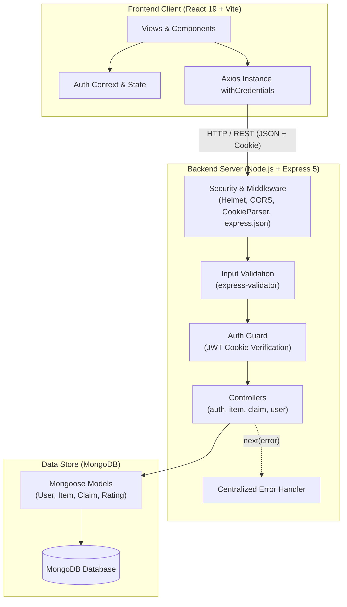
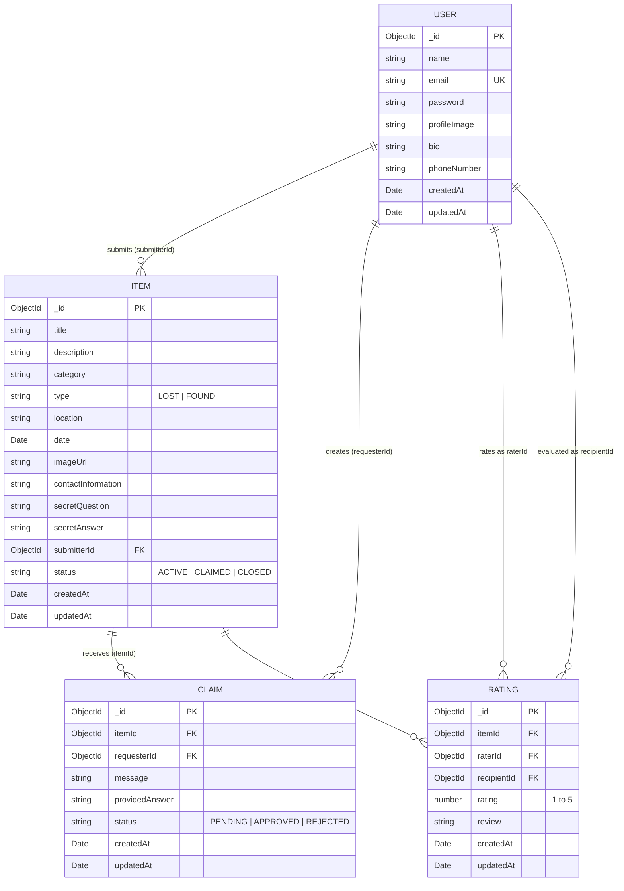

# 👁️ ARGUS Portal — Public Lost & Found Web Application

> **An academic full-stack web application designed to record, search, verify, and resolve lost and found personal belongings with peer-to-peer accountability.**

---

## 📋 Table of Contents

1. [Project Overview](#-project-overview)
2. [Problem Statement & Objectives](#-problem-statement--objectives)
3. [Implemented Features](#-implemented-features)
4. [Technologies Used](#-technologies-used)
5. [System Architecture](#-system-architecture)
6. [Database Schema & Relationships](#-database-schema--relationships)
7. [Project Directory Structure](#-project-directory-structure)
8. [Prerequisites](#-prerequisites)
9. [Installation & Setup (Windows)](#-installation--setup-windows)
10. [Environment Variables](#-environment-variables)
11. [Running the Application](#-running-the-application)
12. [API Reference](#-api-reference)
13. [Authentication & Security](#-authentication--security)
14. [Validation & Error Handling](#-validation--error-handling)
15. [Manual Testing & Verification](#-manual-testing--verification)
16. [Screenshots](#-screenshots)
17. [Limitations & Future Enhancements](#-limitations--future-enhancements)
18. [Academic Project Information](#-academic-project-information)

---

## 🔍 Project Overview

**ARGUS Portal** is a modern, responsive web application designed to address the inefficiency and lack of accountability in community lost-and-found recovery. Built on a decoupled **MERN architecture** (MongoDB, Express.js, React, Node.js), ARGUS provides an authenticated, centralized system where users can register misplaced items, document discovered articles, review claims via security question challenges, track personal listings, and build community trust through verified return ratings.

---

## 🎯 Problem Statement & Objectives

### Problem Statement
In universities, institutions, and public venues, lost and found processes are typically informal and disorganized:
- **Fragmented Channels:** Notices are scattered across message boards, social media groups, and physical desks with no unified searchability.
- **False Claims & Theft:** Without ownership verification, anyone can claim valuable items (wallets, electronics, IDs) without proof.
- **Lack of Transparency:** Finders and owners have no status tracking or feedback loops once an item is reported or handed over.

### Objectives
1. **Centralize Listings:** Provide a single repository where active reports are indexed with timestamps, locations, categories, and descriptions.
2. **Safeguard Ownership:** Enable security verification questions (secret question/answer challenge) so only rightful owners can substantiate claims before handovers.
3. **Streamline Management:** Allow submitters to edit and delete their reports, review incoming claims, and mark items as claimed in real time.
4. **Foster Accountability:** Incentivize returns and discourage false claims using an automated reputation tier system and verified peer ratings.

---

## ✨ Implemented Features

Every feature listed below is fully implemented and backed by working code in the repository:

### 1. User Authentication & Session Management
- **Registration & Login:** Account creation with unique email validation, hashed password storage using `bcrypt`, and secure login.
- **HTTP-Only Cookie Sessions:** JWT tokens are stored in secure, `httpOnly`, `sameSite: 'strict'` cookies to mitigate client-side cross-site scripting (XSS) token interception.
- **Client Session State:** React `AuthContext` provides global authentication status with automatic local storage synchronization and smooth logout handlers.

### 2. Lost & Found Reporting
- **Categorized Submissions:** Forms tailored for both **LOST** and **FOUND** reports.
- **Predefined Categories:** Electronics, Keys & Cards, Documents & IDs, Bags & Backpacks, Wallets & Purses, Clothing & Apparel, Books & Study Materials, Jewelry & Watches, Personal Accessories, and Other.
- **Verification Question Challenge:** Item finders can specify an optional secret question and answer (e.g., *"What sticker is on the laptop lid?"*) to challenge claimants before handover.
- **Date & Location Tracking:** Mandatory occurrence date, last-seen location, contact details, description, and optional image URL.

### 3. Public Item Registry & Search
- **Live Search & Filtering:** Case-insensitive search across title, description, category, and location.
- **Server-Side Type Filters:** Instant toggle between `All Items`, `Lost`, and `Found` via query parameters.
- **Location Selector:** Dynamic location filtering derived from active listings.
- **Live Counter Badges:** Header indicators showing real-time counts for active lost and found reports.

### 4. Item Details & Submitter Actions
- **Item Overview:** Detailed view showing report status badges (`ACTIVE`, `CLAIMED`, `CLOSED`), submitter information, timestamp, and contact metadata.
- **Ownership Verification Badge:** Highlights whether a verification challenge is configured on the item.
- **In-Place Report Editing:** Submitter-only modal to modify title, category, location, date, description, contact details, and image URL.
- **Report Deletion:** Submitter-only deletion with a confirmation modal, permanently removing the item and cascading deletion of associated claims.

### 5. Claims & Verification Workflow
- **Claim Submission:** Authenticated non-submitters can submit a claim with an explanatory message and their answer to the secret verification question.
- **Self-Claim Prevention:** The backend forbids users from claiming their own submitted listings.
- **Submitter Claim Management:** Finders review incoming claims and choose to **Approve** or **Reject**.
- **Automated Cascading Resolution:** Approving a claim automatically transitions the item status to `CLAIMED` and sets all competing pending claims to `REJECTED`.

### 6. Personal Control Dashboard
- **Key Metric Cards:** High-level summary displaying Total Lost, Total Found, Active Listings, and Resolved Items.
- **Tabbed Views:** Separate views for `Overview`, `My Lost Items`, `My Found Items`, `Incoming Claims`, and `My Submitted Claims`.
- **Card-Level Actions:** Directly trigger report editing or report deletion with immediate UI state synchronization.

### 7. Reputation & Trust Rating System
- **Server-Calculated Reputation:** Verified points system awarding +10 pts for valid reports and +150 pts for completed returns.
- **Achievement Tiers:** Bronze (0–99), Silver (100–299), Gold (300–599), Platinum (600–999), Diamond (1000+), complete with percentage progress bars toward the next tier.
- **Peer Ratings & Reviews:** Following a confirmed item return, claimants submit 1–5 star ratings and written reviews for the finder.
- **Integrity Constraints:** Prevents self-rating, ensures only verified participants of a claimed item can rate, and enforces a database compound unique index to prevent duplicate ratings.
- **Editable Profile:** Users can update their display name, short biography (up to 300 characters), phone number, and avatar image URL.

---

## 🛠️ Technologies Used

### Frontend Architecture
| Technology | Version | Purpose |
| :--- | :--- | :--- |
| **React** | `^19.2.8` | Component-based single-page user interface |
| **Vite** | `^8.3.0` | Fast build tool and local development server |
| **React Router DOM** | `^7.18.4` | Client-side routing, protected routes, and URL params |
| **Tailwind CSS** | `^4.3.3` | Utility-first CSS framework with `@tailwindcss/vite` plugin |
| **Axios** | `^1.20.0` | Promise-based HTTP client with `withCredentials: true` |

### Backend Architecture
| Technology | Version | Purpose |
| :--- | :--- | :--- |
| **Node.js** | `>=18.x` | JavaScript server runtime environment |
| **Express.js** | `^5.2.1` | RESTful API routing, controller logic, and middleware |
| **Mongoose** | `^9.10.2` | Object Data Modeling (ODM) for MongoDB |
| **bcrypt** | `^6.0.0` | Salted password hashing |
| **jsonwebtoken** | `^9.0.3` | Signed token generation for stateless authentication |
| **express-validator** | `^7.3.2` | Request body validation and data sanitization |
| **cookie-parser** | `^1.4.7` | HTTP request cookie parsing |
| **helmet** | `^8.3.0` | HTTP response security header fortification |
| **cors** | `^2.8.6` | Cross-Origin Resource Sharing configuration |
| **dotenv** | `^18.0.3` | Environment variable management |
| **nodemon** | `^3.1.14` | Development auto-reload file watcher |

### Database
| Technology | Description |
| :--- | :--- |
| **MongoDB** | NoSQL document database storing collections for Users, Items, Claims, and Ratings |

---

## 🏛️ System Architecture

ARGUS operates on a decoupled client-server architecture:
1. **Frontend Client:** React application served by Vite, utilizing React Context for global authentication state and Axios for backend communication.
2. **REST API Gateway:** Express.js server running security middleware (`helmet`, `cors`, `cookieParser`) before routing requests through validation and authentication checks.
3. **Database Layer:** MongoDB instances accessed strictly through Mongoose schemas and models.



---

## 🗄️ Database Schema & Relationships

The database utilizes four Mongoose models with referential integrity maintained via Mongoose `ObjectId` references.

### Models Overview

| Model | Primary Purpose | Key Fields |
| :--- | :--- | :--- |
| **User** | Authentication & profile | `name`, `email`, `password`, `profileImage`, `bio`, `phoneNumber` |
| **Item** | Lost & found item listings | `title`, `description`, `category`, `type`, `location`, `date`, `imageUrl`, `contactInformation`, `secretQuestion`, `secretAnswer`, `submitterId`, `status` |
| **Claim** | Item recovery requests | `itemId`, `requesterId`, `message`, `providedAnswer`, `status` |
| **Rating** | Trust evaluation after return | `itemId`, `raterId`, `recipientId`, `rating`, `review` |

### Entity-Relationship Diagram



---

## 📁 Project Directory Structure

```text
ARGUS-Portal/
├── Backend/
│   ├── config/
│   │   └── db.js                        # MongoDB connection logic using Mongoose
│   ├── controllers/
│   │   ├── authController.js            # User registration, login, logout, cookie generation
│   │   ├── claimController.js           # Claim creation, retrieval, approve/reject workflow
│   │   ├── itemController.js            # Item CRUD operations, submitter ownership checks
│   │   └── userController.js            # Profiles, reputation metrics, tier calculations, ratings
│   ├── middleware/
│   │   ├── authMiddleware.js            # JWT cookie verification & req.user attachment
│   │   ├── errorMiddleware.js           # 404 handler and centralized JSON error handler
│   │   └── validateMiddleware.js        # express-validator request rules
│   ├── models/
│   │   ├── Claim.js                     # Claim schema definition
│   │   ├── Item.js                      # Item schema definition
│   │   ├── Rating.js                    # Rating & review schema definition
│   │   └── User.js                      # User schema definition
│   ├── routes/
│   │   ├── authRoutes.js                # /api/auth endpoints
│   │   ├── claimRoutes.js               # /api/claims endpoints
│   │   ├── itemRoutes.js                # /api/items endpoints
│   │   └── userRoutes.js                # /api/users endpoints
│   ├── .env.example                     # Sample template for Backend environment variables
│   ├── API_TESTING.md                   # Complete API testing manual
│   ├── ARGUS_API.postman_collection.json# Ready-to-import Postman test collection
│   ├── package.json                     # Backend scripts and dependencies
│   └── server.js                        # Express app initialization and entry point
│
├── Frontend/
│   ├── public/                          # Static assets and favicon files
│   │   └── argus-logo1.png              # Website brand logo & browser favicon
│   ├── src/
│   │   ├── components/
│   │   │   ├── Footer.jsx               # Universal application footer
│   │   │   ├── Navbar.jsx               # Responsive navigation bar with auth awareness
│   │   │   └── ProtectedRoute.jsx       # Route guard redirecting unauthenticated users
│   │   ├── context/
│   │   │   └── AuthContext.jsx          # React Context managing session & authentication
│   │   ├── pages/
│   │   │   ├── Dashboard.jsx            # User control dashboard, item cards, edit/delete modals
│   │   │   ├── Home.jsx                 # Landing page with hero section & navigation shortcuts
│   │   │   ├── ItemDetails.jsx          # Comprehensive item view, claim modal, edit/delete actions
│   │   │   ├── Items.jsx                # Item registry listing with search and filters
│   │   │   ├── Login.jsx                # User login form
│   │   │   ├── Profile.jsx              # User reputation score, tier progression, rating review form
│   │   │   ├── Register.jsx             # User registration form
│   │   │   └── ReportItem.jsx           # Create Lost or Found item submission form
│   │   ├── services/
│   │   │   ├── api.js                   # Configured Axios instance with credentials enabled
│   │   │   ├── authService.js           # Auth endpoint requests
│   │   │   ├── claimService.js          # Claim endpoint requests
│   │   │   ├── itemService.js           # Item endpoint requests
│   │   │   └── userService.js           # Profile, rating, and reputation endpoint requests
│   │   ├── App.jsx                      # Route configurations & layout structure
│   │   ├── index.css                    # Global Tailwind CSS definitions and custom styles
│   │   └── main.jsx                     # React DOM entry point
│   ├── index.html                       # HTML template with ARGUS favicon and page title
│   ├── package.json                     # Frontend scripts and dependencies
│   └── vite.config.js                   # Vite configuration with Tailwind CSS plugin
│
├── .gitignore                           # Git ignore rules for node_modules and .env files
└── README.md                            # Complete project documentation
```

---

## ⚙️ Prerequisites

Before installing the project, verify that your machine has the following installed:

1. **Node.js**: `v18.x` or `v20.x` LTS recommended ([Download Node.js](https://nodejs.org/)).
2. **npm**: Version `9.x` or higher (installed automatically with Node.js).
3. **MongoDB**:
   - **Option A (Local):** [MongoDB Community Server](https://www.mongodb.com/try/download/community) installed and running locally as a service on port `27017`.
   - **Option B (Cloud):** A free [MongoDB Atlas](https://www.mongodb.com/cloud/atlas) cluster connection string.
4. **Git**: Version control tool ([Download Git](https://git-scm.com/)).

---

## 💻 Installation & Setup (Windows)

Follow these step-by-step instructions in PowerShell or Command Prompt.

### 1. Clone the Repository
```powershell
git clone https://github.com/your-username/ARGUS-Portal.git
cd ARGUS-Portal
```

### 2. Configure the Backend

1. Navigate to the `Backend` directory:
   ```powershell
   cd Backend
   ```
2. Install dependencies:
   ```powershell
   npm install
   ```
3. Create the `.env` configuration file from the template:
   ```powershell
   copy .env.example .env
   ```
4. Open `.env` in any text editor and fill in your connection details (see [Environment Variables](#-environment-variables)).

### 3. Configure the Frontend

1. Open a second terminal window and navigate to the `Frontend` directory:
   ```powershell
   cd ARGUS-Portal\Frontend
   ```
2. Install dependencies:
   ```powershell
   npm install
   ```

---

## 🔐 Environment Variables

The backend relies on environment variables defined in `Backend/.env`. Never commit this file to version control.

### `Backend/.env` Configuration

| Variable | Description | Example / Placeholder Value |
| :--- | :--- | :--- |
| `PORT` | Port number on which Express runs | `5000` |
| `MONGO_URI` | MongoDB connection URI string | `mongodb://localhost:27017/argus_portal` |
| `JWT_SECRET` | Secret key used to sign and verify JWT cookies | `your_strong_jwt_secret_key_here` |
| `NODE_ENV` | Application environment mode | `development` |

Example file content:
```env
PORT=5000
MONGO_URI=mongodb://localhost:27017/argus_portal
JWT_SECRET=replace_with_a_secure_random_string_min_32_chars
NODE_ENV=development
```

> **Note on MongoDB Atlas:** If using MongoDB Atlas, set `MONGO_URI` to your SRV connection string:
> `MONGO_URI=mongodb+srv://<username>:<password>@cluster0.xxxxx.mongodb.net/argus_portal?retryWrites=true&w=majority`

---

## 🚀 Running the Application

ARGUS runs frontend and backend processes concurrently in separate terminals.

### Terminal 1 — Backend API Server
```powershell
cd ARGUS-Portal\Backend
npm run dev
```
*Expected Console Output:*
```text
Server is running on port 5000 in development mode
MongoDB Connected: 127.0.0.1
```
The REST API is now live at: `http://localhost:5000`

### Terminal 2 — Frontend Client
```powershell
cd ARGUS-Portal\Frontend
npm run dev
```
*Expected Console Output:*
```text
  VITE v8.3.0  ready in 250 ms

  ➜  Local:   http://localhost:5173/
  ➜  Network: use --host to expose
```
Open your browser and navigate to: `http://localhost:5173`

---

## 🌐 API Reference

All API routes are prefixed with `/api`. Protected routes require a valid `jwt` cookie.

### System Endpoints
| Method | Endpoint | Access | Description |
| :--- | :--- | :--- | :--- |
| `GET` | `/api/health` | Public | Server health status verification |

### Authentication (`/api/auth`)
| Method | Endpoint | Access | Description |
| :--- | :--- | :--- | :--- |
| `POST` | `/api/auth/register` | Public | Register new user account with hashed password |
| `POST` | `/api/auth/login` | Public | Authenticate credentials and issue HTTP-only cookie |
| `POST` | `/api/auth/logout` | Public | Clear HTTP-only session cookie |

### Items (`/api/items`)
| Method | Endpoint | Access | Description |
| :--- | :--- | :--- | :--- |
| `GET` | `/api/items` | Public | List active items (supports `?type=LOST\|FOUND` & `?category=`) |
| `GET` | `/api/items/my` | Private | List all items reported by the authenticated user |
| `GET` | `/api/items/:id` | Public | Retrieve complete details for a single item |
| `POST` | `/api/items` | Private | Submit a new Lost or Found item report |
| `PUT` | `/api/items/:id` | Private (Owner) | Update an existing report submitted by the user |
| `DELETE` | `/api/items/:id` | Private (Owner) | Delete a report and cascade-delete its linked claims |

### Claims (`/api/claims`)
| Method | Endpoint | Access | Description |
| :--- | :--- | :--- | :--- |
| `POST` | `/api/claims` | Private | Submit an ownership claim on an item |
| `GET` | `/api/claims` | Private | Retrieve all incoming claims submitted on user's items |
| `GET` | `/api/claims/my` | Private | Retrieve all claims submitted by the current user |
| `PUT` | `/api/claims/:id` | Private (Owner) | Approve or reject an incoming claim |

### Users & Reputation (`/api/users`)
| Method | Endpoint | Access | Description |
| :--- | :--- | :--- | :--- |
| `GET` | `/api/users/profile` | Private | Retrieve user profile, reputation metrics, tier, and rateable returns |
| `PUT` | `/api/users/profile` | Private | Update editable fields (`name`, `bio`, `profileImage`, `phoneNumber`) |
| `POST` | `/api/users/rate` | Private | Submit a 1–5 star trust rating and review for a completed return |
| `GET` | `/api/users/:id` | Public | Retrieve public profile and reputation data of a user |

---

## 🛡️ Authentication & Security

1. **Password Hashing:** User passwords are never stored in plain text. Passwords undergo cryptographic salted hashing with `bcrypt` using 10 salt rounds prior to persistence.
2. **Stateless JWT with HTTP-Only Cookies:** Tokens are signed using `process.env.JWT_SECRET` with a 30-day validity. They are transported strictly via `httpOnly`, `sameSite: 'strict'` cookies, protecting tokens against browser-based script inspection and XSS attacks.
3. **Backend Authorization Guards:**
   - Report updates (`PUT /api/items/:id`) and deletions (`DELETE /api/items/:id`) enforce server-side ownership verification (`item.submitterId === req.user._id`).
   - Claim approval/rejection (`PUT /api/claims/:id`) verifies that only the original item submitter can alter claim statuses.
   - Users cannot submit claims on items they reported themselves.
   - Users cannot rate themselves or rate unverified returns.
4. **Header Hardening:** Express utilizes `helmet()` to establish HTTP security headers (preventing clickjacking, sniffing, and cross-site injection).
5. **CORS Whitelisting:** Cross-Origin Resource Sharing is strictly constrained to `http://localhost:5173` with credentials explicitly enabled.

---

## 🧪 Validation & Error Handling

### Request Validation
The backend leverages `express-validator` middleware rules:
- **Registration:** Name required, email must be valid format, password must be $\ge 6$ characters.
- **Login:** Email and password mandatory.
- **Item Creation:** Title, type (`LOST` or `FOUND`), and location are strictly verified.
- **Claim Creation:** Valid MongoId format required for `itemId`, and message string is mandatory.

### Centralized Error Handling
All controllers pass runtime exceptions to Express via `next(error)`. The centralized error middleware (`errorMiddleware.js`) standardizes responses:
- **404 Not Found:** Handled for undefined endpoints or missing document IDs.
- **CastError (Invalid ObjectId):** Formatted automatically to a clean `404 Resource not found`.
- **Duplicate Key Error (code 11000):** Formatted to `400 Duplicate value entered, record already exists`.
- **Validation Errors:** Extracts and joins schema validation constraints into clear messages.
- **Stack Trace Protection:** Stack traces are suppressed when `NODE_ENV === 'production'`.

---

## 🔬 Manual Testing & Verification

For automated Postman testing, refer to [API_TESTING.md](file:///d:/Eng.Ayad/Academics/ARGUS-Portal/Backend/API_TESTING.md) or import [ARGUS_API.postman_collection.json](file:///d:/Eng.Ayad/Academics/ARGUS-Portal/Backend/ARGUS_API.postman_collection.json).

### End-to-End User Verification Workflow

1. **User Registration & Login:**
   - Navigate to `/register` and create User A (`alex@university.edu`).
   - Log out, open `/login`, and sign in. Confirm redirection to `/dashboard` or home.
2. **Reporting an Item:**
   - Click **Report Item** (`/report`) and select **Found**.
   - Fill in Title (*"Silver Keys with Blue Carabiner"*), Category (*"Keys & Cards"*), Location (*"Library 2nd Floor"*), and Date.
   - Add a Secret Question (*"How many keys are on the ring?"*) and Secret Answer (*"3"*). Submit the report.
3. **Registry Browsing & Search:**
   - Go to `/items`.
   - Enter *"Keys"* in the search box; confirm real-time filtering.
   - Filter by type: click **Found**; verify that only found reports remain visible.
4. **Submitting a Claim:**
   - Log out, and register User B (`sam@university.edu`).
   - Browse to the keys listing at `/items/:id`.
   - Click **Claim This Item**. Notice the Secret Question challenge is displayed.
   - Provide an explanatory message and the answer (*"3"*). Submit the claim.
5. **Approving a Claim & Cascading Resolution:**
   - Log back in as User A. Navigate to `/dashboard` $\rightarrow$ **Incoming Claims**.
   - Review User B's answer and click **Approve Claim**.
   - Confirm the item status changes to `CLAIMED`.
6. **Submitting a Trust Rating:**
   - Log back in as User B. Navigate to `/profile`.
   - Locate the item under **Pending Feedback / Rateable Returns**.
   - Submit a 5-star rating with a review (*"Keys returned quickly, thank you!"*).
   - Check User A's profile (`/api/users/:id` or reputation block) to verify score and tier advancement.
7. **Editing & Deletion:**
   - As User A, open `/dashboard` and click **Edit** on an active listing. Modify details and save.
   - Click **Delete** on an item card. Confirm the confirmation modal warning. Confirm deletion and verify the listing disappears from both the dashboard and the `/items` registry.

---

## 📸 Screenshots

> *Placeholder sections for application screenshots to be attached for final project submission.*

### 1. Landing Page & Hero Section
*Showcases the modern hero banner, navigation bar, and registry search entrance.*
```text
[ Placeholder: Add screenshot of Home.jsx hero view here ]
```

### 2. Public Item Registry & Filters
*Displays active listings, live search bar, type filtering pills, and responsive cards.*
```text
[ Placeholder: Add screenshot of Items.jsx registry page here ]
```

### 3. Item Details & Verification Challenge
*Shows report specifications, secret question ownership prompt, and claim submission form.*
```text
[ Placeholder: Add screenshot of ItemDetails.jsx view here ]
```

### 4. User Personal Dashboard
*Presents summary statistics cards, tabbed views, and item management actions.*
```text
[ Placeholder: Add screenshot of Dashboard.jsx view here ]
```

### 5. Profile & Verified Reputation Tier
*Illustrates verified points, tier progression bar (Bronze–Diamond), and peer rating reviews.*
```text
[ Placeholder: Add screenshot of Profile.jsx reputation section here ]
```

---

## 🚧 Limitations & Future Enhancements

### Current System Limitations
1. **Direct Image Uploads:** Currently supports external image URLs rather than multipart file streaming to object storage.
2. **Communication Channel:** Communication occurs via claim submission messages and provided contact info rather than live in-app chat.
3. **Notification Delivery:** Notifications are reflected in-app via status badges and dashboards rather than background email dispatch or push webhooks.

### Proposed Future Enhancements
- [ ] **Cloud Storage Integration:** Integrate AWS S3 or Cloudinary with `multer` for direct file upload from mobile cameras and desktops.
- [ ] **Interactive Geolocation Maps:** Integrate Leaflet / Mapbox to pin exact lost and found geographic coordinates on an interactive campus map.
- [ ] **Automated AI Matching:** Utilize image similarity embeddings and natural language processing to calculate match probabilities between lost and found descriptions.
- [ ] **Direct P2P Real-Time Chat:** Implement WebSocket (Socket.io) private messaging between item finders and verified claimants.

---

## 🎓 Academic Project Information

| Field | Details |
| :--- | :--- |
| **Project Title** | ARGUS Portal — Smart Lost & Found Web Application |
| **Course / Degree** | [ Insert Degree / Course Name, e.g., B.Tech / B.E. / B.Sc in Computer Science ] |
| **Department** | [ Insert Department, e.g., Department of Computer Science & Engineering ] |
| **Institution** | [ Insert University / College Name ] |
| **Academic Year** | [ Insert Academic Year, e.g., 2025 – 2026 ] |
| **Student Name** | [ Insert Student Name ] |
| **Roll / Register Number** | [ Insert Student Roll / ID Number ] |
| **Project Supervisor / Guide** | [ Insert Supervisor Name & Designation ] |

---

*This project was developed for academic evaluation and community utility. For inquiries or contributions, please contact the project author.*
